# The Modern Azure Journey: Where Data Meets AI — Extending Azure Databricks Investments with Microsoft Fabric Interoperability

*Published: November 3, 2026 | Technical Architecture & Interoperability Guide*

---

When organizations discuss enterprise AI, the conversation almost always begins with foundation models, prompts, and agents. Yet in practice, every production enterprise AI initiative succeeds or fails based on how well it answers three equally critical questions:

1. **Where does the trusted enterprise data come from?**
2. **How does business intelligence and context get created from that data?**
3. **Where will business users ultimately experience and consume that intelligence?**

This is the modern Azure journey: **Data → Intelligence → Experience**.

And at the very start of this journey sits a foundational architectural principle that guides everything in this post:

> **Modernization does not mean forced migration.**  
> *Don't change a customer's existing Azure Databricks architecture just to introduce Microsoft Fabric or AI. Instead, demonstrate what additional Microsoft capabilities can be layered around their existing investment with zero data duplication.*

---

## Why "Why Would We Change Our Architecture?" Is the Right Question

If an enterprise has spent years building curated Medallion architectures (Bronze, Silver, Gold), Lakeflow / Delta Live Tables (DLT) pipelines, and fine-grained governance in **Azure Databricks Unity Catalog**, asking them to rip-and-replace or duplicate pipelines just to light up Power BI Direct Lake or Microsoft Foundry agents is a non-starter.

A modern lakehouse strategy shouldn't say: *"Here is how to leave Databricks."*  
Instead, it should prove: **"Here is how an organization already invested in Azure Databricks can extend that architecture with Microsoft Fabric, OneLake, and Microsoft Foundry—while minimizing architectural disruption and avoiding unnecessary data movement."**

### Data Is 1/3 of the Story: The 3-Act Framework

As we designed our end-to-end reference implementation, we structured the architecture around three distinct acts. Your Databricks and Fabric connectivity foundation is **Act 1**—the essential 1/3 that unlocks the entire downstream AI and user experience:

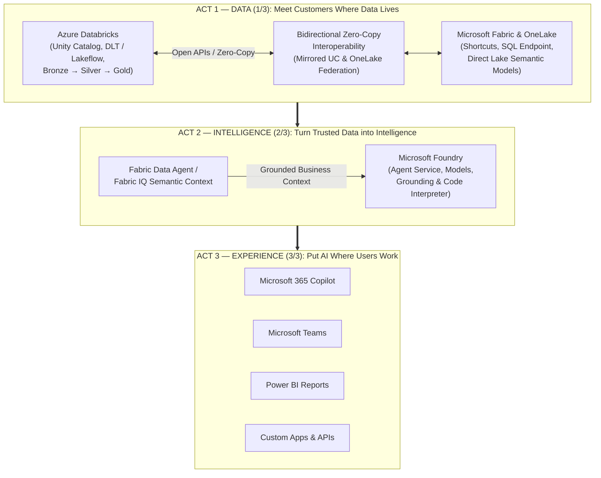

| Act | Pillar | Guiding Principle | Key Question Answered | Core Technologies |
| :--- | :--- | :--- | :--- | :--- |
| **Act 1 (1/3)** | **DATA** | *Meet customers where their data already lives.* | Where is my enterprise data, and how can the broader Microsoft ecosystem work with it without copying it? | Azure Databricks, Unity Catalog, Microsoft Fabric, OneLake, Direct Lake |
| **Act 2 (2/3)** | **INTELLIGENCE** | *Turn trusted business data into intelligence.* | How can AI models and agents reason over governed enterprise metrics rather than raw schemas? | Fabric Data Agents, Semantic Models, Microsoft Foundry, Azure OpenAI |
| **Act 3 (3/3)** | **EXPERIENCE** | *Bring intelligence to where work happens.* | Where and how will business users actually consume this intelligence without knowing the underlying plumbing? | Microsoft 365 Copilot, Microsoft Teams, Power BI, Custom APIs/Apps |

---

## State of the Union (As of November 2026): Azure Databricks & Microsoft Fabric Connectivity

As of late 2026, Azure Databricks and Microsoft Fabric interoperability has matured into a **true bidirectional, zero-copy ecosystem** built on open standards (Delta Lake, Apache Iceberg, and Unity Catalog Open APIs).

Here is the complete landscape of how the two platforms connect today:

### 1. Inbound to Fabric: Mirroring Azure Databricks Unity Catalog (Generally Available)
- **How it works:** Fabric connects directly to your Azure Databricks Unity Catalog metastore using the Unity Catalog Open APIs. It creates a **Mirrored Azure Databricks catalog** item in Fabric and automatically generates OneLake shortcuts (`Databricks` type shortcuts) pointing to the underlying ADLS Gen2 Delta tables.
- **Zero-Copy & Auto-Sync:** **No data is moved or duplicated.** When schemas, tables, materialized views, or streaming tables are added or dropped in Databricks Unity Catalog, Fabric automatically synchronizes the metadata (typically propagating changes within seconds to a few minutes).
- **Streaming Tables & Materialized Views Support:** By enabling `TBLPROPERTIES ('pipelines.externalMetadata.enabled' = 'true')` on your DLT / Lakeflow pipelines or standalone objects, even Databricks Materialized Views and Streaming Tables can be mirrored directly into Fabric.
- **Built-in Consumption:** Every Mirrored Azure Databricks catalog item automatically provisions a **SQL Analytics Endpoint** (for T-SQL queries, views, and warehousing), supports **OneLake table shortcuts** into Fabric Lakehouses, and powers **Power BI Direct Lake** semantic models and **Fabric Data Agents**.

### 2. Outbound from Fabric: OneLake Catalog Federation in Azure Databricks (Preview / Beta)
- **How it works:** Going the other direction, Azure Databricks **Lakehouse Federation** now natively supports **OneLake Catalog Federation** (`CREATE CONNECTION ... TYPE onelake` and `CREATE FOREIGN CATALOG`).
- **Zero-Copy Access from Databricks Compute:** Data engineers and data scientists running on **Databricks Runtime 18.0+** (or **DBR 19.0+** using workspace-specific endpoints `<workspace-id>.z<xy>.dfs.fabric.microsoft.com`) and **SQL Warehouses (2025.40+)** can query Fabric **Lakehouse** and **Warehouse** tables directly using standard three-part Unity Catalog names (`fabric_catalog.schema.table`) with zero data copying.
- **Unstructured Data Volume Support:** Setting `create_volume_for_lakehouse_files 'true'` automatically mounts the Fabric Lakehouse `/Files` directory as a read-only Unity Catalog Volume (`/Volumes/<catalog-name>/onelake-folders/files/`) for Spark binary/Parquet/PDF processing in Databricks.

### 3. Shared Storage: OneLake & ADLS Gen2 Shortcuts
- Both platforms can continue to read/write to existing **ADLS Gen2** storage accounts, or Databricks can mount/read/write directly to OneLake endpoints (`abfss://<workspace>@onelake.dfs.fabric.microsoft.com/`) using Entra ID Service Principals, Managed Identities (via Access Connectors for Azure Databricks), or credential passthrough.

---

## What Our E2E Interoperability Implementation Proves (The 5 Architectural Proofs)

To make this concrete—following the philosophy of **Build Once → Prove It → Document It → Enable Others**—our end-to-end walkthrough is designed to prove five non-negotiable enterprise requirements:

1. **Existing Databricks investment remains meaningful:** We start with a realistic Azure Databricks environment where data engineers curate Bronze, Silver, and Gold tables via Delta Live Tables (DLT) / Lakeflow pipelines registered in Unity Catalog.
2. **Interoperability is real (not slideware):** We configure live Unity Catalog Mirroring into Fabric and OneLake Catalog Federation back into Databricks.
3. **Unnecessary data movement is eliminated:** We explicitly show what stays in Azure Databricks and ADLS Gen2 (100% of the physical Parquet/Delta files) versus what gets federated into Fabric (metadata and zero-copy pointers).
4. **Fabric layers immediate business value:** Rather than stopping at *"I can see my Databricks table in Fabric,"* we layer a **Power BI Direct Lake semantic model**, **Copilot in Power BI**, and a **Fabric Data Agent** on top of the mirrored Databricks tables.
5. **Governance and security boundaries are preserved:** We document exact authentication, network firewall rules (Workspace Identity + Trusted Workspace Access), and where Unity Catalog vs. OneLake security policies are enforced.

---

## End-to-End Walkthrough: One Business Scenario, Multiple Personas

Let's walk through a unified enterprise scenario across four personas—**Data Engineer**, **Analytics Engineer / BI Analyst**, **AI Developer**, and **Business User**—answering a single executive business question:

> *"Why are sales declining and customer churn rising in our target segments, and which products and retention actions should we prioritize?"*

---

### Act 1 — DATA: Extending the Existing Azure Databricks Estate into Microsoft Fabric

#### Step 1: Curate Enterprise Data in Azure Databricks (Data Engineer Persona)

Our data engineering team already runs its core ingestion and Medallion transformations in **Azure Databricks**. We do **not** rewrite these pipelines in Fabric.

From the Azure Portal, we launch our existing Unity Catalog-enabled Azure Databricks workspace and sign in with Microsoft Entra ID:

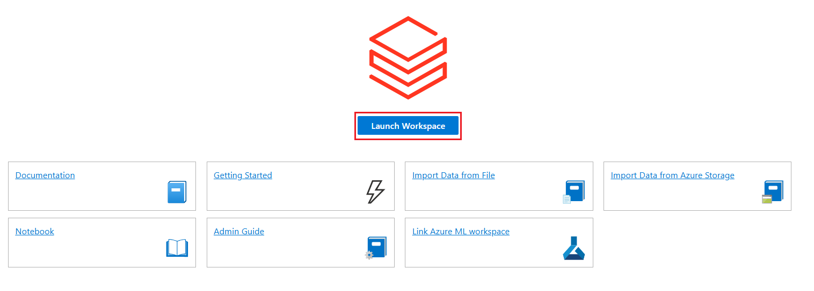

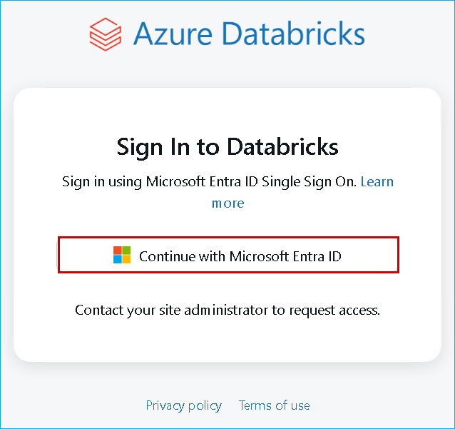

Inside Azure Databricks, our raw and curated enterprise datasets (customer churn, internet/reseller sales transactions, and campaign performance) are processed using **Jobs & Pipelines (Delta Live Tables / Lakeflow Declarative Pipelines)**:

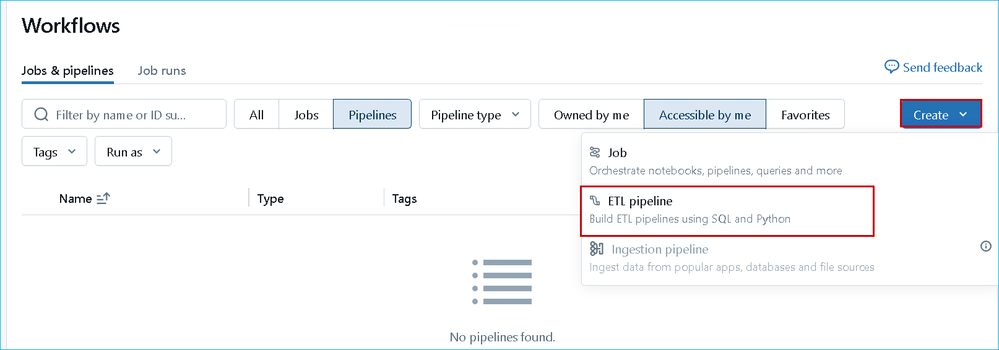

We configure our pipeline (`DLT_Pipeline`) pointing to our transformation notebook and target Unity Catalog schema:

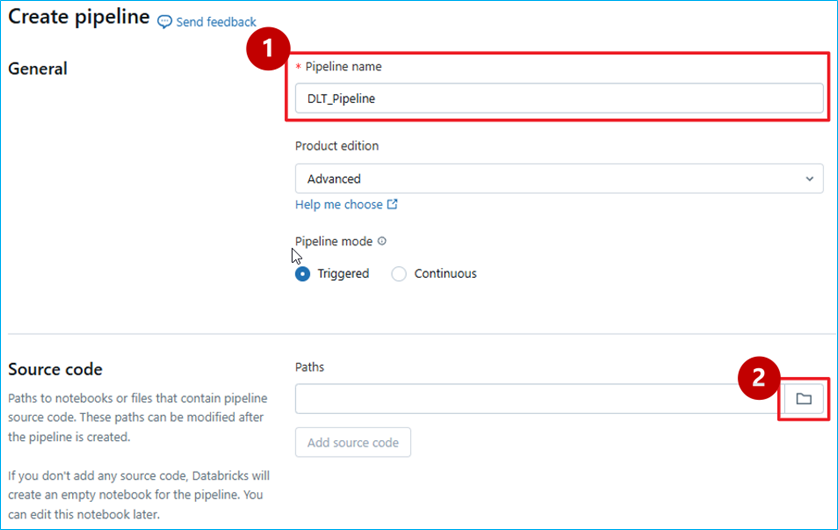

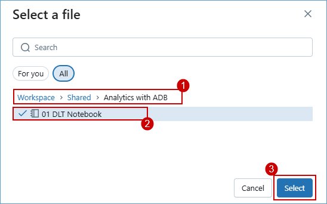

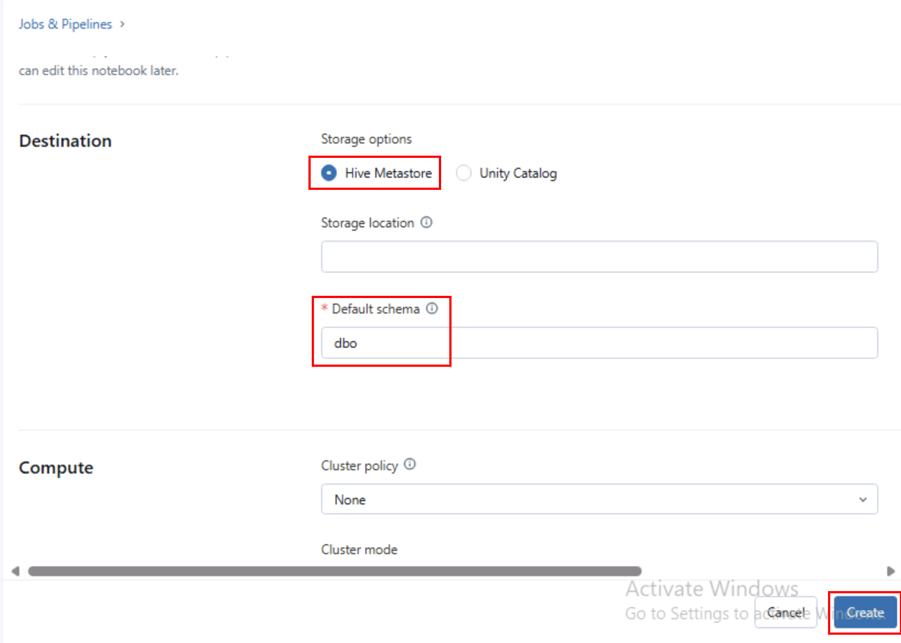

When we run the pipeline, Azure Databricks orchestrates the declarative Bronze → Silver → Gold data quality expectations and materializes the governed tables in Unity Catalog:

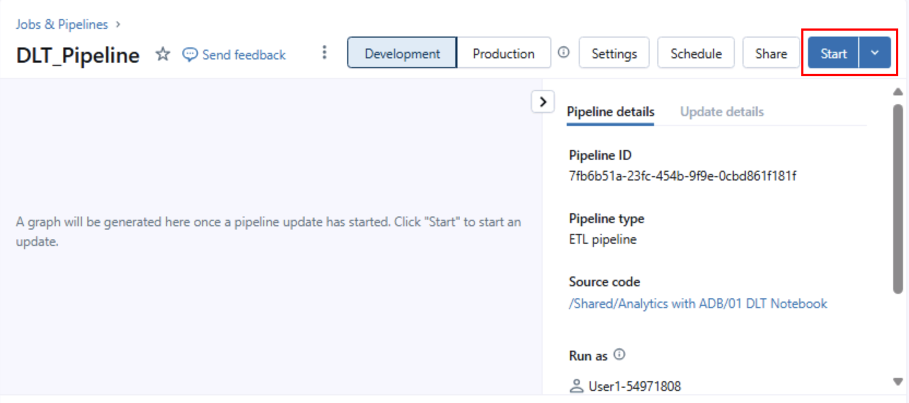

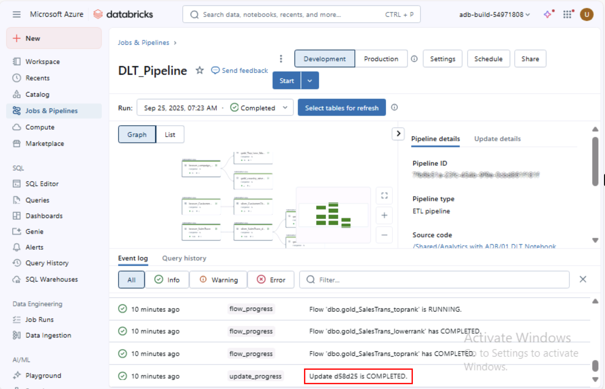

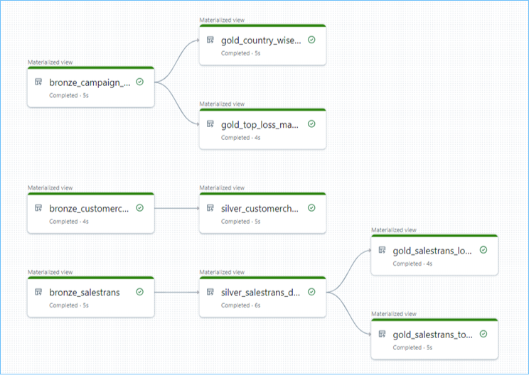

To ensure that any **Materialized Views** or **Streaming Tables** produced by our Databricks pipelines can also be discovered by external engines like Microsoft Fabric, we ensure external data access is enabled on the Unity Catalog metastore, grant `EXTERNAL USE SCHEMA` and `SELECT` privileges, and tag streaming/materialized pipeline outputs with:

```sql
-- Enable external metadata access for Streaming Tables / Materialized Views in Unity Catalog
TBLPROPERTIES ('pipelines.externalMetadata.enabled' = 'true')
```

---

#### Step 2: Zero-Copy Mirroring of Azure Databricks Unity Catalog into Microsoft Fabric

Now, without moving a single byte of data out of ADLS Gen2 or rewriting a single Spark job, we expose our governed `litware_unity_catalog` to Microsoft Fabric.

1. In the **Microsoft Fabric portal** (`https://app.fabric.microsoft.com`), open your target workspace, select **+ New item**, and choose **Mirrored Azure Databricks catalog**:

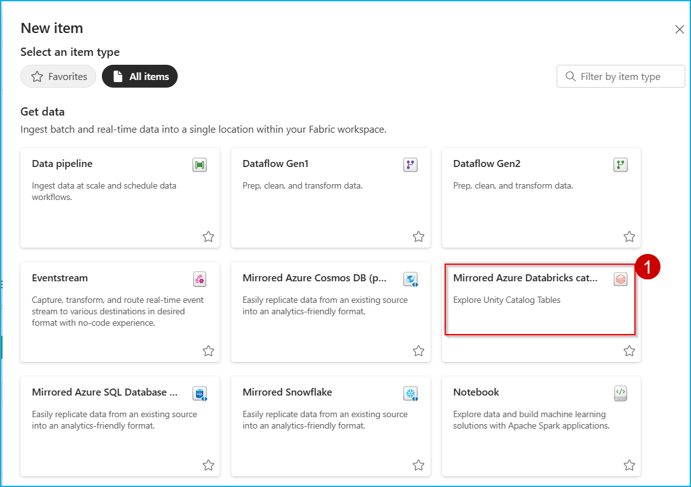

2. Create a connection to your Azure Databricks workspace. You can authenticate using **Organizational account (OAuth)** or a **Microsoft Entra Service Principal** (providing the Workspace URL, Tenant ID, Client ID, and Secret):

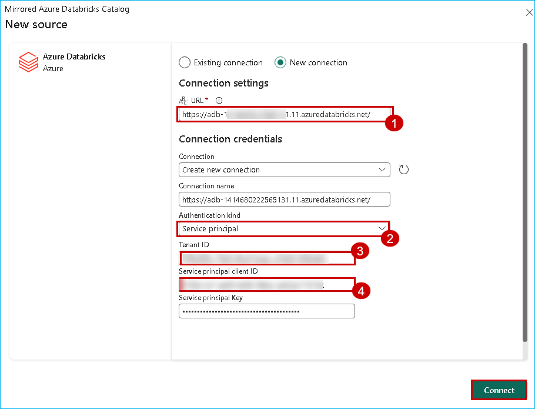

3. On the **Choose data** screen, Fabric queries the Unity Catalog Open APIs and displays all catalogs, schemas, and tables to which your credential has `USE CATALOG`, `EXTERNAL USE SCHEMA`, and `SELECT` permissions. Here, we select `litware_unity_catalog` and include our curated schemas (`default` and `rag`), leaving **Automatically sync future catalog changes for the selected schema** enabled:

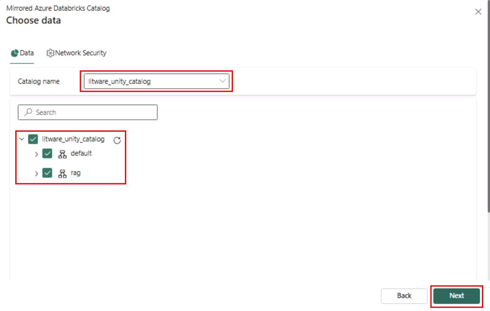

4. If your underlying ADLS Gen2 storage account is locked down behind an **Azure Storage Firewall**, switch to the **Network Security** tab during setup to bind an ADLS Gen2 connection using **Fabric Workspace Identity** and **Trusted Workspace Access**:

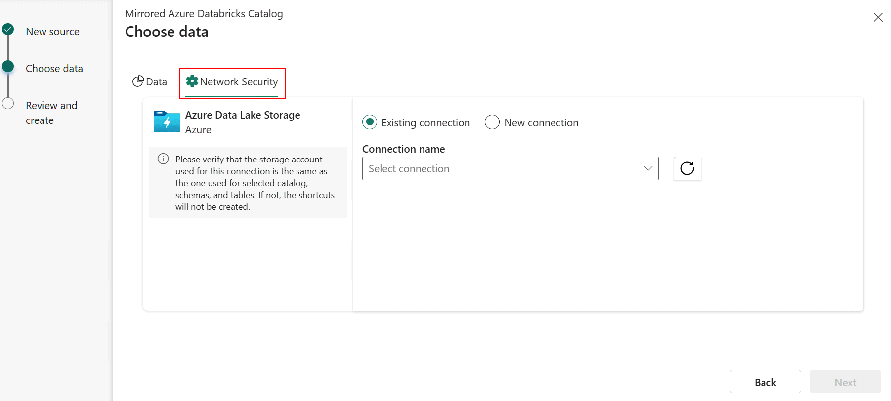

5. Click **Create**. Within seconds, Fabric creates the Mirrored Azure Databricks catalog item along with an auto-generated **SQL analytics endpoint**. Switching to the SQL analytics endpoint Explorer pane, we can immediately browse the mirrored Unity Catalog schemas and query the Databricks Delta tables using standard T-SQL—with **zero data replication**:

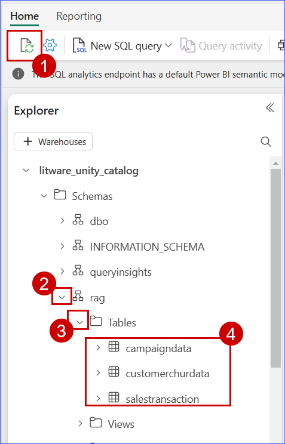

---

#### Step 3: Combining Databricks Tables with Fabric Lakehouses via OneLake Shortcuts

What if a Fabric data engineer or data scientist wants to join these mirrored Azure Databricks tables with other enterprise tables inside a consolidated **Fabric Lakehouse** (`ZavaLakehouse`)?

Because the Mirrored Unity Catalog registers its tables in **OneLake**, we don't need to configure another external connection:

1. Open `ZavaLakehouse`, click the ellipsis (`...`) next to the `dbo` schema under **Tables**, and select **New table shortcut**:

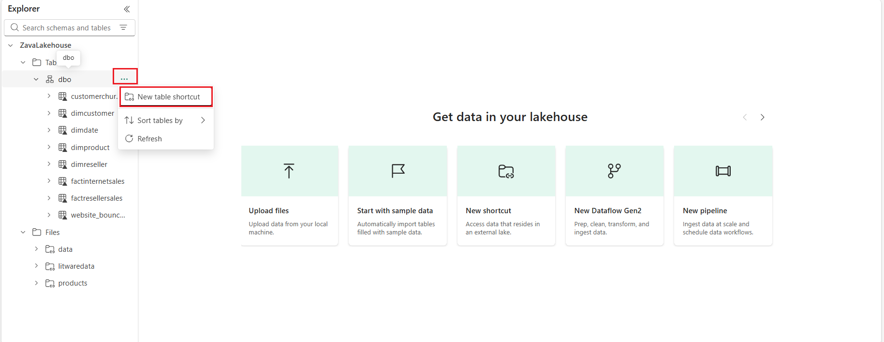

2. Under **Internal sources**, select **Microsoft OneLake** and pick the mirrored `litware_unity_catalog` item:

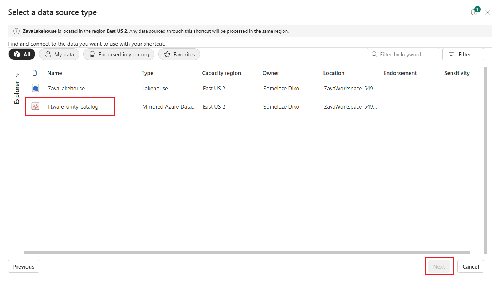

3. Expand the mirrored schema (`rag`) and select the curated Databricks tables (`campaigndata__tbl`, `customerchurdata__tbl`, `salestransaction__tbl`):

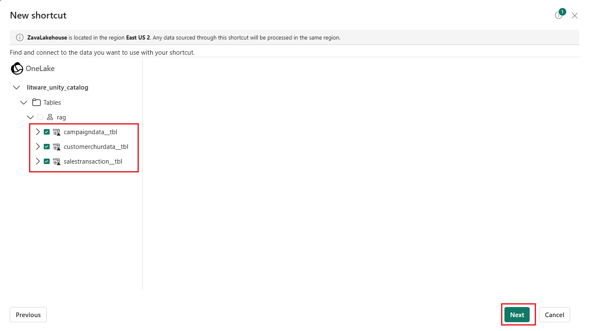

4. Click **Create**. The Databricks Unity Catalog tables now appear natively alongside Fabric Lakehouse tables under `dbo`, ready for cross-platform joins, semantic modeling, and AI grounding:

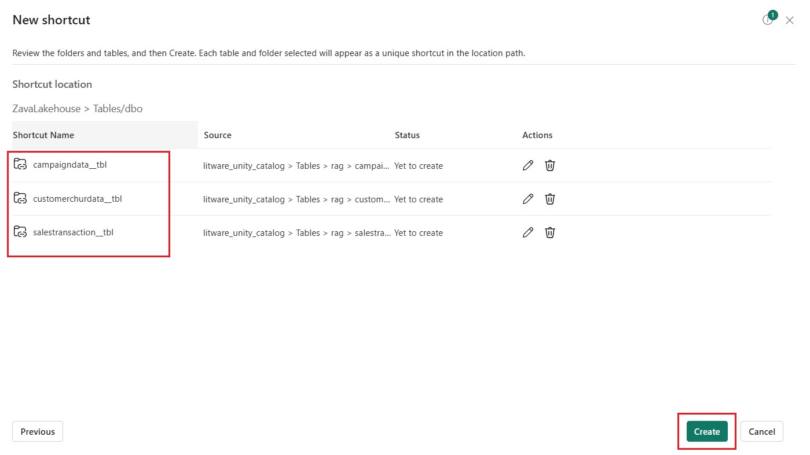

---

#### Step 4: Bidirectional Flow — Reading OneLake Data Back in Azure Databricks via Catalog Federation

Interoperability is a two-way street. Suppose an analytics team curates a new table inside a Fabric Lakehouse or Warehouse, and your machine learning team in **Azure Databricks** wants to use it for feature engineering—again, **without copying data**.

Using **OneLake Catalog Federation** (available on Databricks Runtime 18.0+ / 19.0+ and SQL Warehouses 2025.40+), you can federate any Fabric Lakehouse or Warehouse directly into Unity Catalog:

```sql
-- 1. Create a Unity Catalog connection to Microsoft Fabric OneLake
-- (Uses a Storage Credential backed by an Azure Databricks Access Connector Managed Identity or Service Principal)
CREATE CONNECTION fabric_onelake_conn TYPE onelake
OPTIONS (
  workspace '<fabric-workspace-guid>',
  credential 'onelake_managed_identity_cred'
);

-- 2. Create a Foreign Catalog in Unity Catalog pointing to your Fabric Lakehouse
CREATE FOREIGN CATALOG IF NOT EXISTS zava_fabric_lakehouse
USING CONNECTION fabric_onelake_conn
OPTIONS (
  data_item '<fabric-lakehouse-guid>',
  item_type 'Lakehouse',
  create_volume_for_lakehouse_files 'true'
);

-- 3. Query Fabric OneLake tables directly from Azure Databricks compute (Zero-Copy!)
SELECT
  c.CustomerSegment,
  COUNT(DISTINCT c.CustomerId) AS TotalCustomers,
  ROUND(AVG(s.TotalAmount), 2) AS AvgOrderValue
FROM zava_fabric_lakehouse.dbo.dimcustomer c
JOIN litware_unity_catalog.rag.salestransaction__tbl s
  ON c.CustomerId = s.CustomerId
GROUP BY c.CustomerSegment
ORDER BY AvgOrderValue DESC;
```

---

### Act 2 — INTELLIGENCE: Turning Trusted Data into Business Context & AI

Showing that Fabric can see a Databricks table is only Act 1. **Act 2** answers the question: *How do we transform trusted enterprise data into business context and an intelligent reasoning layer?*

#### Step 1: Build a Direct Lake Semantic Model & Power BI Experience (Analytics Persona)

Directly from our Fabric Lakehouse (or directly from the Mirrored Azure Databricks catalog item), our business analyst clicks **New semantic model** in the ribbon:

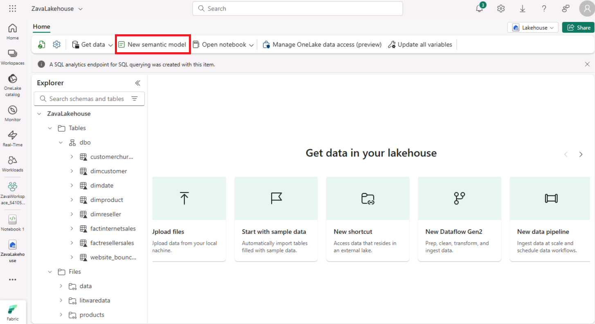

We select the shortcutted/mirrored tables to build a **Direct Lake** semantic model. Because Direct Lake reads the Delta Parquet files directly from storage into memory without scheduled import refreshes, Power BI reports reflect the latest Azure Databricks pipeline runs in near real-time:

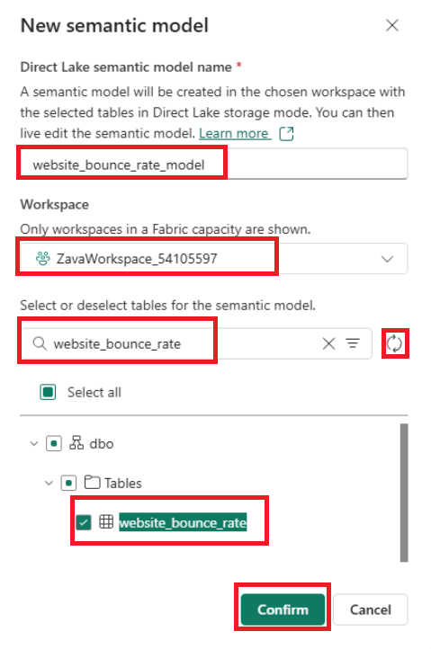

With **Copilot in Power BI**, analysts can immediately ask natural-language questions (*"Create a detailed page to analyze Website Bounce Rate and customer churn"*) to generate interactive visuals and executive narrative summaries:

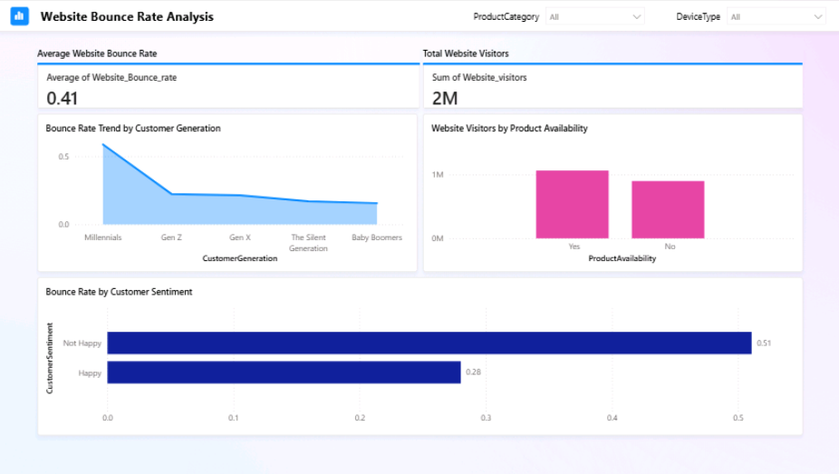

---

#### Step 2: Create a Governed Fabric Data Agent with Business Instructions

To prepare our enterprise data for conversational AI and multi-agent orchestration, we create a **Fabric Data Agent** in our workspace:

1. Select **+ New item** → **Data Agent** and name it `ZavaDataAgent`:

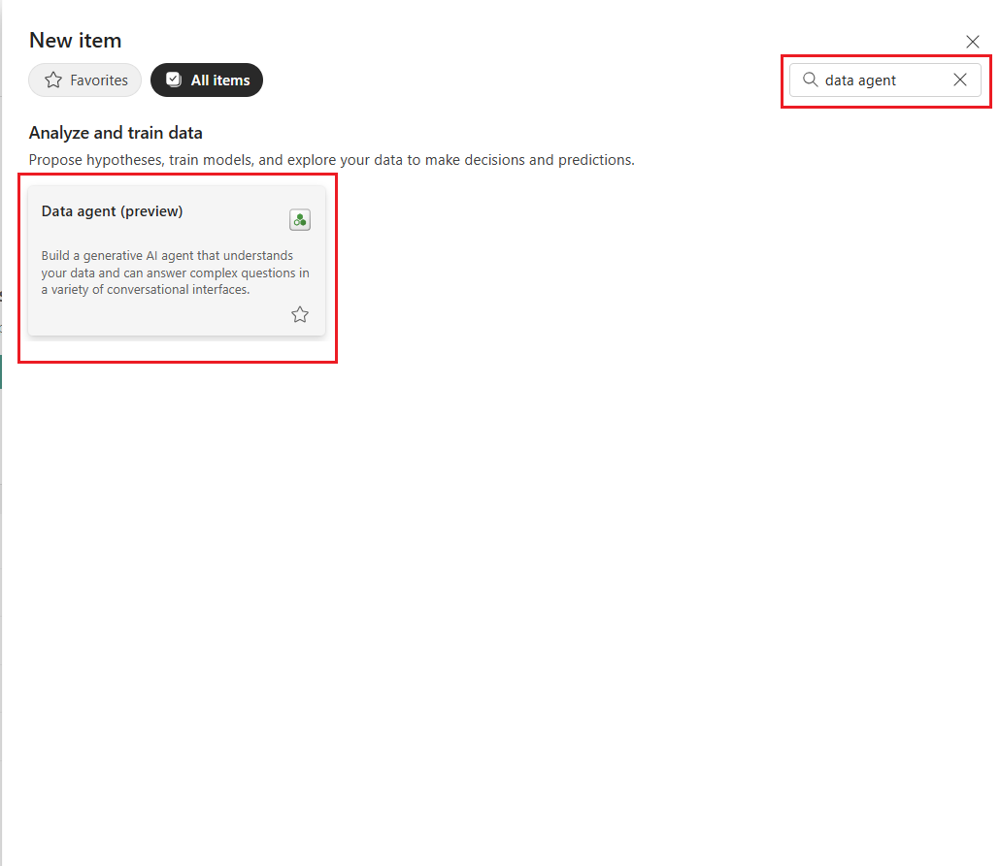

2. Connect `ZavaLakehouse` (which includes our shortcutted Azure Databricks tables `campaigndata__tbl`, `customerchurdata__tbl`, and `salestransaction__tbl` alongside our dimension tables):

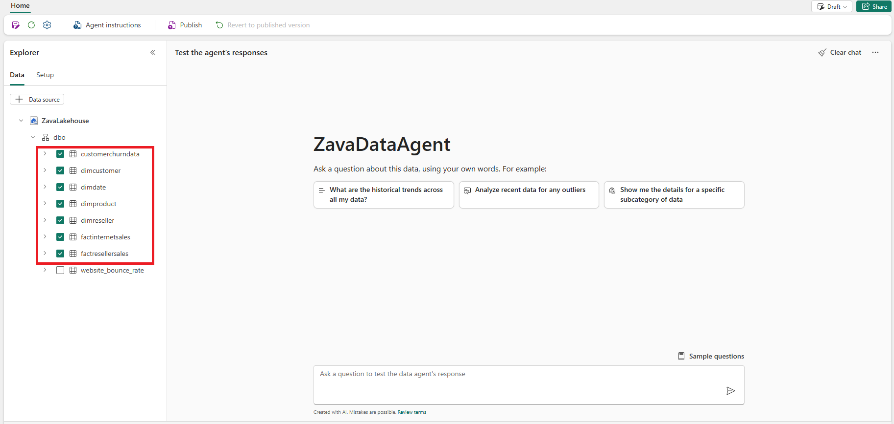

3. **Crucial Step — Adding Business Context:** Raw table schemas are not enough for reliable enterprise AI. In the Data Agent setup, we configure **Agent Instructions** (defining business rules, such as measuring *"most sold products"* by total sales revenue rather than unit quantity, and specifying which churn tables to use) along with verified **Example SQL queries**:

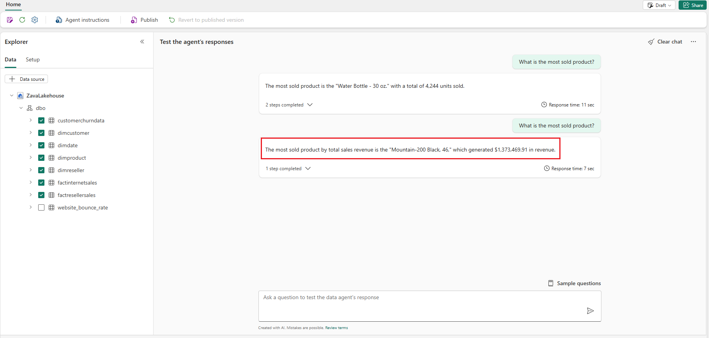

4. Once validated, we click **Publish** to expose `ZavaDataAgent` as a governed knowledge source for the broader Azure AI ecosystem:

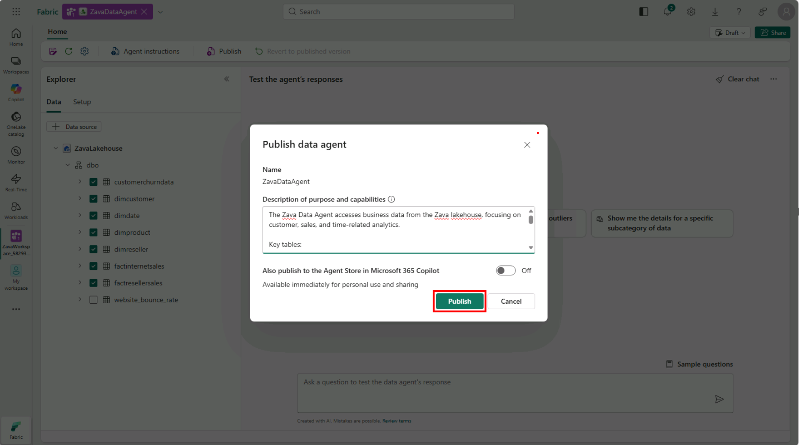

---

### Act 3 — EXPERIENCE: Bringing Intelligence to Where Work Happens with Microsoft Foundry

Building a data agent inside Fabric doesn't finish the enterprise story. **Act 3** answers: *How do we orchestrate this data intelligence with other enterprise tools and surface it where business users actually work (Copilot, Teams, APIs, or custom applications)?*

1. In **Microsoft Foundry** (formerly Azure AI Foundry), we navigate to **Management center** → **Connected resources** → **+ New connection** and select **Microsoft Fabric** under **Agent Knowledge Tools**, linking our `workspace-id` and `artifact-id` from `ZavaDataAgent`:

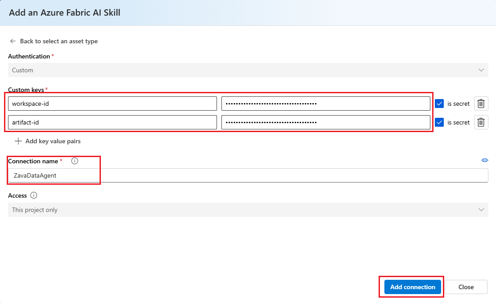

2. Next, in the Foundry **Agents** builder, we create our `Zava Insights Agent` backed by `gpt-4o` (or your preferred frontier model), attach the **Microsoft Fabric (`ZavaDataAgent`)** connection under **Knowledge**, and enable **Code Interpreter** under **Actions**:

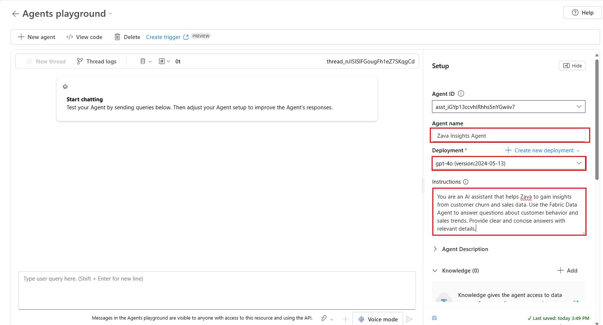

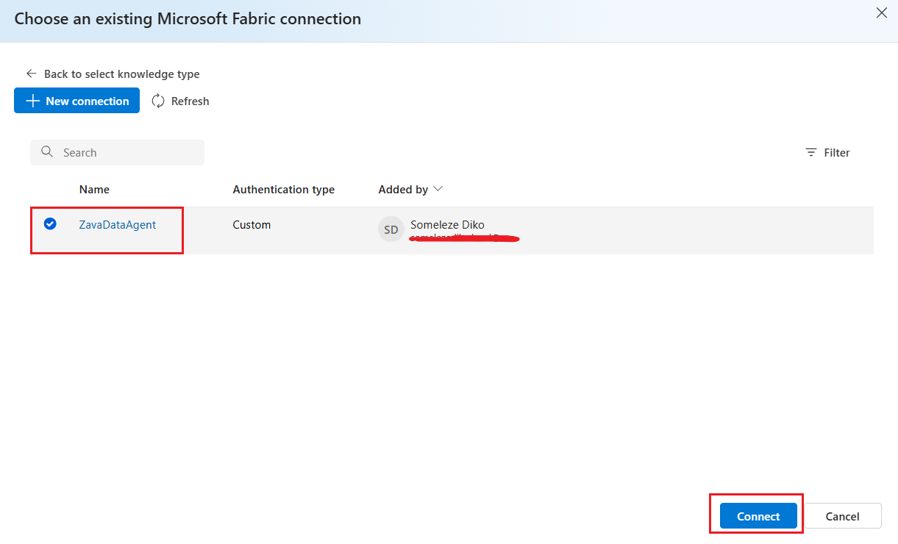

3. When a business user asks a complex question—such as *"What are the top 5 selling products by total revenue, and can you show me a bar chart?"*—the Microsoft Foundry agent delegates the structured data retrieval to the **Fabric Data Agent** (which queries the underlying **Azure Databricks Unity Catalog** tables via OneLake with zero data movement) and uses **Code Interpreter** to render visual analytics on the fly:

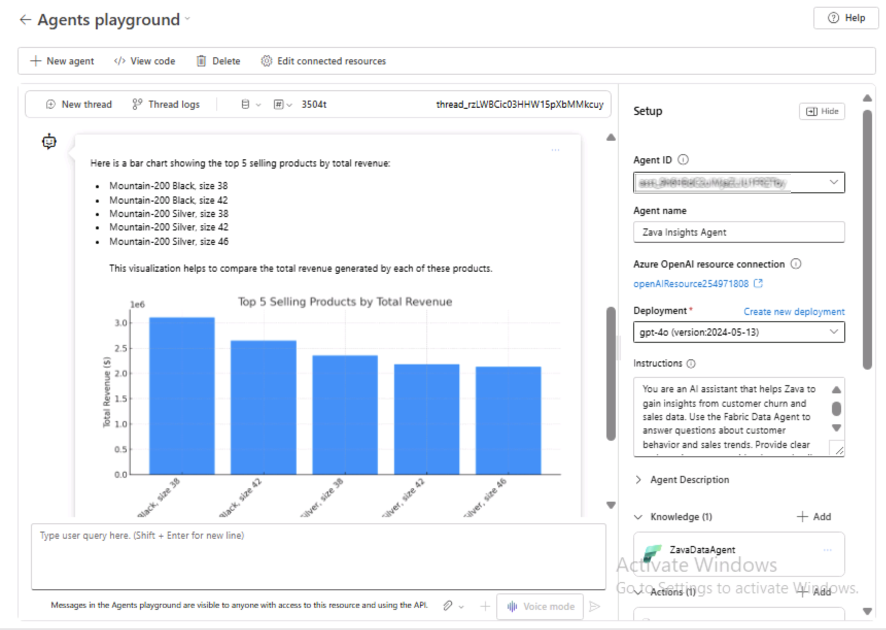

From Microsoft Foundry, this agent can be published with one click to **Microsoft 365 Copilot**, **Microsoft Teams**, or consumed via the **Foundry Agent REST API / SDK** inside a custom line-of-business application.

> **The Ultimate Reveal:**  
> The business user interacting in Microsoft Teams or Copilot never needs to know whether a table was engineered in Azure Databricks, mirrored via Unity Catalog Open APIs, shortcutted into OneLake, or orchestrated by Microsoft Foundry.  
> **The architecture can be sophisticated. The user experience shouldn't have to be.**

---

## Enterprise Governance, Security & Networking Reference

One of the 5 core requirements of our architecture is **preserving governance boundaries** and documenting clearly where authentication, authorization, and network security are enforced.

### What Stays Where & Who Governs What?

| Architectural Layer | What Lives Here | Authentication & Identity | Authorization & Governance Boundary |
| :--- | :--- | :--- | :--- |
| **Storage Layer (ADLS Gen2)** | Physical Delta Lake / Parquet files managed by Azure Databricks | **Fabric Workspace Identity** (for Azure Storage Firewall traversal via Trusted Workspace Access) | Folder/Container RBAC (`Storage Blob Data Reader` + `Read/Execute` ACLs). |
| **Azure Databricks Unity Catalog** | Primary table definitions, DLT/Lakeflow lineage, ETL jobs, ML models | **Service Principal** or **Organizational Account (OAuth)** configured in the Fabric connection | Requires `USE CATALOG`, `EXTERNAL USE SCHEMA`, and `SELECT`. Controls which schemas/tables can be discovered and mirrored. |
| **Microsoft Fabric (Mirrored UC & OneLake)** | Zero-copy catalog metadata, OneLake shortcuts, SQL Analytics Endpoint | **Microsoft Entra ID** (single identity plane across Azure & Fabric) | **Important:** Unity Catalog RLS/CLM policies do *not* automatically carry over into Fabric. Access in Fabric is governed by **Fabric Workspace Roles**, **Item Permissions**, and **OneLake Security (Data Access Roles)** synced via Entra ID groups. |
| **OneLake Catalog Federation (Fabric → Databricks)** | Foreign Catalog pointers in Unity Catalog reading Fabric Lakehouse/Warehouse | **Azure Databricks Access Connector (Managed Identity)** or **Service Principal** + OneLake short-lived user-delegated SAS tokens | Governed in Databricks via `USE CATALOG`, `USE SCHEMA`, and `SELECT` on the Foreign Catalog; backed by Fabric `Read all OneLake data` permissions. |
| **Fabric Data Agent & Microsoft Foundry** | Semantic instructions, NL2SQL generation, agent orchestration | **On-Behalf-Of (OBO) User Identity Pass-Through** | Queries executed by the Fabric Data Agent inside Microsoft Foundry run under the **calling user's Entra ID identity**, ensuring users only see data they are authorized to read in Fabric. |

### Key Limitations & Best Practices to Keep in Mind (As of November 2026)

1. **Row-Level Security (RLS) & Column-Level Masking (CLM):** Tables with active Unity Catalog RLS/CLM policies, Delta Sharing tables, and standard views cannot be mirrored directly via Unity Catalog Mirroring. Best practice: Sync your **Microsoft Entra ID groups** to both Unity Catalog and Fabric, and apply **OneLake Data Access Roles** (or SQL Analytics Endpoint/Semantic Model RLS) in Fabric.
2. **Firewall-Protected ADLS Gen2 Gotcha:** Even if you authenticate to Azure Databricks using a **Service Principal**, when your ADLS Gen2 storage account is behind an Azure Storage firewall, Fabric uses the **Fabric Workspace Identity** to traverse the storage firewall. Always allowlist the Workspace Identity via a **Resource Instance Rule** on the storage account.
3. **OneLake Federation Runtime Endpoints:** When reading OneLake data from Azure Databricks on **Databricks Runtime 19.0+**, compute connects via workspace-specific endpoints (`<workspace-id>.z<xy>.dfs.fabric.microsoft.com`) rather than the global `onelake.dfs.fabric.microsoft.com` endpoint. Ensure outbound firewall rules or Private Link DNS zones (`privatelink.fabric.microsoft.com`) include the workspace endpoints.

---

## Summary: Build Once → Prove It → Document It → Enable Others

When advising enterprise customers who have invested heavily in Azure Databricks, our message is simple:

- **Don't disrupt what works:** Keep your battle-tested Spark engineering, Lakeflow/DLT pipelines, and Unity Catalog governance in Azure Databricks.
- **Connect without copying:** Use **Mirrored Azure Databricks Unity Catalog** and **OneLake Catalog Federation** to create a bidirectional, zero-copy bridge between Azure Databricks and Microsoft Fabric.
- **Complete the Data → Intelligence → Experience journey:** Use Microsoft Fabric to turn raw tables into business-ready semantic context (Direct Lake & Fabric Data Agents), **Microsoft Foundry** to build multi-tool reasoning agents, and **Copilot / Teams / Apps** to put intelligence directly in the flow of work.
