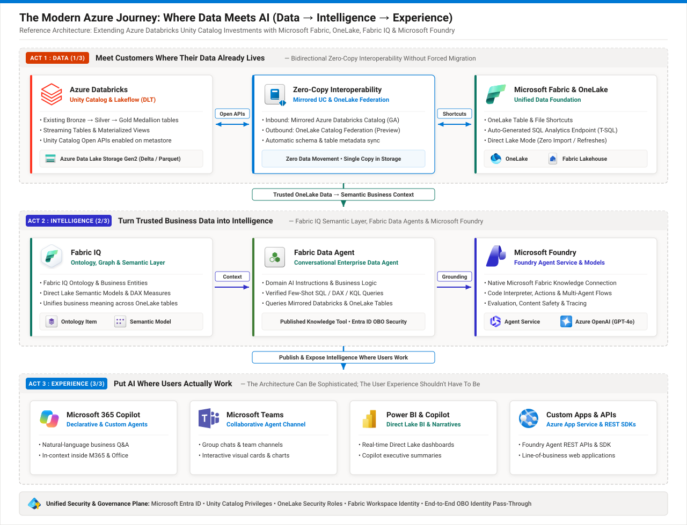

# Live Customer POC & Demo Playbook: The Modern Azure Journey (Data → Intelligence → Experience)

*Deployed & Verified in Sandbox Environment: `admin@MngEnvMCAP927255.onmicrosoft.com`*



---

## 1. Live Sandbox Environment Inventory (Pre-Configured & Verified)

Everything in this POC is **already live and running** in your Azure and Microsoft Fabric sandbox environment. You can click any of the links below during your customer presentation:

| Architectural Layer | Resource Name | ID / Endpoint | Direct Portal Link |
| :--- | :--- | :--- | :--- |
| **Entra ID Tenant** | `Contoso` | `afa6899d-aa46-4992-a3eb-5c8015aa5d1f` | `admin@MngEnvMCAP927255.onmicrosoft.com` |
| **Azure Subscription** | `ME-MngEnvMCAP927255-masinav-1` | `9e114e9d-1e81-4b56-9ddd-55bae9226770` | [Azure Portal](https://portal.azure.com) |
| **Act 1: Azure Databricks Workspace** | `dbrx-mirroring-pe-fabric` (`lumen-rg`, `westus3`) | `https://adb-7405607060119348.8.azuredatabricks.net` | [Open Databricks Catalog Explorer](https://adb-7405607060119348.8.azuredatabricks.net/explore/data?o=7405607060119348) |
| **Act 1: Databricks Serverless SQL Warehouse** | `serverless` | `4a57219370b180ea` | [Open Databricks SQL Editor](https://adb-7405607060119348.8.azuredatabricks.net/sql/editor?o=7405607060119348) |
| **Act 1: Managed Unity Catalog (Inbound to Fabric)** | `fabric_mirror_catalog.sales_schema` | ADLS Gen2: `sadatabrickslab01` (`ext-location`) | Tables: `sales_data`, `regional_sales_performance`, `customer_churn_risk` |
| **Act 1: OneLake Foreign Catalog (Outbound to Databricks)** | `fabric_onelake_federation.dbo` | UC Connection: `dbrx1lake` (Type: `ONELAKE`) | Federates Fabric Lakehouse `Snowflake_LH` (`fe3259d5-6703-4584-a309-14175eb49d10`) |
| **Act 1: Microsoft Fabric Workspace** | `ws_1_copilotdemo` | `8b72677f-f882-4123-93bd-6da6856677be` | [Open Fabric Workspace](https://app.fabric.microsoft.com/groups/8b72677f-f882-4123-93bd-6da6856677be/list?experience=fabric-developer) |
| **Act 1: Mirrored Azure Databricks Catalog Item** | `fabric_mirror_catalog` | Item ID: `473edebe-1fe3-451a-88ad-9831f4e3c62e`<br/>SQL Endpoint ID: `43cf8b31-a1ae-4a6a-b64d-b8dfcd96a76b` | `twe2nl2gvkjeti7llsablks5d4-p5txfc4c7arude55nwtikztxxy.datawarehouse.fabric.microsoft.com` |
| **Act 1 & 2: Fabric Lakehouse (with OneLake Shortcuts)** | `LH_IQDemo` | Item ID: `f36c92a3-76c8-4a49-a57f-f12c1f251ee2` | Shortcuts: `dbrx_sales_data`, `dbrx_regional_sales_performance`, `dbrx_customer_churn_risk` |
| **Act 2: Fabric IQ Ontology & Semantic Models** | `Telecom_OntologyIQ`, `Demo_Ontology_1`, `mirrored_semantic_model_dbrx` | Ontology ID: `b87b2352-62a6-4fa8-9359-7f60da878fe0`<br/>Semantic Model ID: `83565604-d98b-4420-8d23-0716ea972b38` | Governed inside `ws_1_copilotdemo` |
| **Act 2: Fabric Data Agent** | `mirror agent` | Item ID: `682f5859-088d-4713-9d4d-28a4f5cbe3e8` | Grounded over mirrored Databricks & OneLake tables |
| **Act 2 & 3: Microsoft Foundry** | `aishu-ai-foundry` / `aishu-foundry-project` | `https://aishu-ai-foundry.cognitiveservices.azure.com/` | Model Deployment: `gpt-4o` |

---

## 2. Customer Talk Track & Step-by-Step Live Demo Script (15–20 Minutes)

### Opening Hook (1 Minute)
> *"When organizations talk about enterprise AI, the conversation usually starts with models and agents. But in reality, customers ask us a much more fundamental question first: **'Why would we change our existing Azure Databricks architecture just to use Microsoft Fabric and AI?'**"*
>
> *"Today, I'm going to show you live in our environment why **modernization does not mean migration**. We will walk through three acts—**Data (1/3)**, **Intelligence (2/3)**, and **Experience (3/3)**—answering one real business question end-to-end without moving or duplicating a single byte of data."*

**The Business Question We Will Answer Live:**
> *"Why are sales declining and product returns rising in the Southwest region, how much annualized revenue is at risk from customer churn, and what specific retention action should we take for each account?"*

---

### ACT 1 — DATA (1/3): Meet Customers Where Their Data Already Lives (6 Minutes)

#### Demo Step 1.1: Show the Existing Azure Databricks Unity Catalog Estate
1. Open the [Azure Databricks Catalog Explorer](https://adb-7405607060119348.8.azuredatabricks.net/explore/data?o=7405607060119348).
2. Expand **`fabric_mirror_catalog`** → **`sales_schema`**.
3. Show the three Delta tables managed in Unity Catalog and stored on ADLS Gen2 (`abfss://ext-location@sadatabrickslab01.dfs.core.windows.net/`):
   - `sales_data`
   - `regional_sales_performance`
   - `customer_churn_risk`
4. Open the Databricks SQL Editor (attached to the `serverless` SQL Warehouse) and run:

```sql
-- Run in Azure Databricks SQL Editor
SELECT
  region,
  product_name,
  customer_segment,
  SUM(units_sold) AS units_sold,
  ROUND(SUM(total_revenue), 2) AS total_revenue,
  SUM(CASE WHEN return_flag = 'Yes' THEN 1 ELSE 0 END) AS return_txns
FROM fabric_mirror_catalog.sales_schema.regional_sales_performance
GROUP BY region, product_name, customer_segment
ORDER BY region, total_revenue DESC;
```

**What to point out to the customer:**
- Nothing in the customer's Databricks Medallion pipeline changed. Data stays in their existing ADLS Gen2 storage account (`sadatabrickslab01`) governed by Unity Catalog.

---

#### Demo Step 1.2: Show Inbound Zero-Copy — Mirrored Azure Databricks Catalog in Microsoft Fabric
1. Switch to your browser tab for the [Microsoft Fabric Workspace (`ws_1_copilotdemo`)](https://app.fabric.microsoft.com/groups/8b72677f-f882-4123-93bd-6da6856677be/list?experience=fabric-developer).
2. Open the **`fabric_mirror_catalog`** item (type: *Mirrored Azure Databricks catalog*).
3. Show that `sales_schema.sales_data`, `sales_schema.regional_sales_performance`, and `sales_schema.customer_churn_risk` are mirrored with `autoSync: Enabled`.
4. Switch to the **SQL analytics endpoint** of `fabric_mirror_catalog` (or open **`LH_IQDemo`** where we created OneLake table shortcuts `dbrx_regional_sales_performance` and `dbrx_customer_churn_risk` alongside Apache Iceberg tables `subscribers_iceberg` and `network_events_iceberg`!) and run this T-SQL query:

```sql
-- Run in Microsoft Fabric SQL Analytics Endpoint (LH_IQDemo or fabric_mirror_catalog)
SELECT
  r.region,
  COUNT(DISTINCT r.transaction_id) AS transactions,
  ROUND(SUM(r.total_revenue), 2) AS total_sales_revenue,
  COUNT(DISTINCT CASE WHEN c.churn_status = 'Yes' THEN c.customer_id END) AS high_risk_customers,
  ROUND(SUM(DISTINCT CASE WHEN c.churn_status = 'Yes' THEN c.annualized_revenue ELSE 0 END), 2) AS annualized_revenue_at_risk
FROM dbo.dbrx_regional_sales_performance r
LEFT JOIN dbo.dbrx_customer_churn_risk c
  ON r.region = c.region
GROUP BY r.region
ORDER BY total_sales_revenue DESC;
```

**What to point out to the customer:**
- Notice in `LH_IQDemo` under `/Tables`, we have **Databricks Unity Catalog Delta tables** (`dbrx_regional_sales_performance`, `dbrx_customer_churn_risk`) sitting side-by-side with **Iceberg tables** (`subscribers_iceberg`, `network_events_iceberg`)—all via OneLake shortcuts with **zero data movement**.

---

#### Demo Step 1.3: Show Outbound Zero-Copy — OneLake Catalog Federation Back into Azure Databricks
1. Switch back to the [Azure Databricks Catalog Explorer](https://adb-7405607060119348.8.azuredatabricks.net/explore/data?o=7405607060119348).
2. Click on the foreign catalog **`fabric_onelake_federation`** (type: `FOREIGN_CATALOG`, connection: `dbrx1lake` of type `ONELAKE`).
3. Run this federated query in Databricks SQL to prove Databricks can query 165 million rows directly from Microsoft Fabric OneLake without copying data:

```sql
-- Run in Azure Databricks SQL Editor (Querying Microsoft Fabric OneLake directly!)
SELECT COUNT(*) AS total_fabric_onelake_customers
FROM fabric_onelake_federation.dbo.customer;
```

---

### ACT 2 — INTELLIGENCE (2/3): Turn Trusted Business Data into Intelligence (5 Minutes)

#### Demo Step 2.1: Show Fabric IQ (Ontology & Semantic Layer) + Direct Lake
1. In the Fabric workspace `ws_1_copilotdemo`, point out:
   - **Direct Lake Semantic Model:** `mirrored_semantic_model_dbrx` (reads Delta files directly from OneLake without scheduled import refreshes).
   - **Fabric IQ Ontology:** `Demo_Ontology_1` and `Telecom_OntologyIQ` (maps raw tables into business entities, relationships, and semantic rules).

#### Demo Step 2.2: Show the Governed Fabric Data Agent (`mirror agent`)
1. Open the **`mirror agent`** item (`682f5859-088d-4713-9d4d-28a4f5cbe3e8`) in `ws_1_copilotdemo`.
2. Show how **Agent Instructions** define business context over the mirrored Databricks tables:
   - *Rule 1:* Evaluate product and regional performance using `total_revenue` and `return_flag` from `dbrx_regional_sales_performance`.
   - *Rule 2:* Calculate `annualized_revenue` at risk from `dbrx_customer_churn_risk` where `churn_status = 'Yes'` and always include `recommended_retention_action`.
3. Ask the Data Agent in Fabric:
   - `"Which customers in the Southwest region are at risk of churning, what is their annualized revenue, and what retention action should we take?"`

---

### ACT 3 — EXPERIENCE (3/3): Put AI Where Users Actually Work (4 Minutes)

#### Demo Step 3.1: Run the End-to-End Automated Live POC Script (or Microsoft Foundry Playground)
To show the complete 3-Act pipeline executing live in one command—querying **OneLake Federation in Databricks**, querying **Mirrored Databricks tables in Fabric `LH_IQDemo`**, and grounding **Microsoft Foundry (`aishu-ai-foundry` / `gpt-4o`)** to produce an executive action plan—run:

```powershell
python .\poc\run_live_poc_demo.py
```

**What the Live Script Proves in Real Time:**
1. **Act 1A (Outbound Federation):** Queries `165,000,000` rows from Fabric OneLake (`fabric_onelake_federation.dbo.customer`) via Azure Databricks Serverless SQL.
2. **Act 1B (Inbound Mirroring & Shortcuts):** Queries live regional sales and customer churn risk from `LH_IQDemo.dbo.dbrx_regional_sales_performance` and `LH_IQDemo.dbo.dbrx_customer_churn_risk` via the Fabric SQL Analytics Endpoint.
3. **Act 2 & 3 (Intelligence & Experience):** Passes the governed Fabric context to **Microsoft Foundry (`gpt-4o` on `aishu-ai-foundry`)**, which synthesizes the root cause of the Southwest decline ($78,240 annualized revenue at risk across 4 accounts, driven by 64.9%–74.2% mobile portal bounce rates and Legacy LTE throttling) and prescribes account-by-account retention actions.

---

## 3. Live Demo Verification Commands (Quick Reference)

If you ever want to re-seed or reset the demo tables in Azure Databricks and re-sync the shortcuts into Fabric `LH_IQDemo` before a customer call, simply run:

```powershell
# Run the live E2E POC verification & demo script
python .\poc\run_live_poc_demo.py
```
